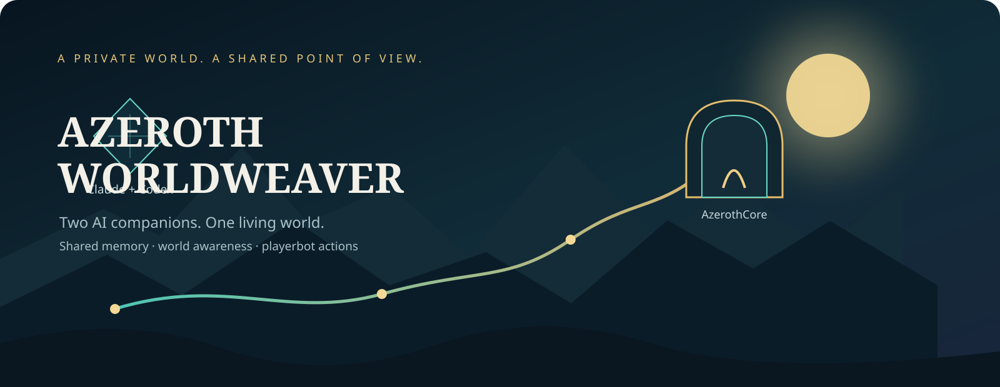
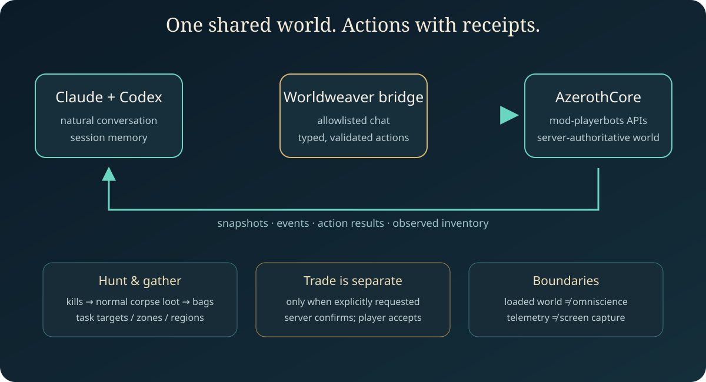

<div align="center">



[](#status)
[](#requirements)
[](LICENSE)

**English** · [Українська](README.uk.md)

*Natural conversation. Shared world awareness. Real playerbot actions.*

</div>

## Azeroth, shared

Azeroth Worldweaver connects **Claude** and **Codex** to a privately hosted World of Warcraft 3.3.5a world running AzerothCore and mod-playerbots. Both companions can use the same server-observed context, remember recent sessions, and turn an authorized player's ordinary chat into bounded, server-validated character actions.

This repository is the source and integration package for that experiment. It does not include AzerothCore itself, a client, game data, database dumps, server configuration, logs, or credentials.

## What works

| Capability | Included behavior |
|---|---|
| Shared world context | Group members, loaded nearby creatures and objects, selected target, inventory/equipment, skills/spells, quest progress, events, and server freshness metadata. Data is captured from the server; unseen or unloaded parts of the world remain unknown. |
| Natural chat and session memory | The adapters keep recent conversation and durable local summaries to reduce topic drift across restarts. Memory is private runtime data, never committed. It informs the model; it does not authorize actions. |
| Combat assignments | Hunt one or more matching hostile creature types in the current area or a selected map/zone/area. Tasks track kills, keep combat on the selected targets, collect the resulting normal corpse loot, and report progress. |
| Loot and trade | Gathered items remain in the bot's bags. Delivery is a separate request: the bridge offers only requested, tradeable items through WoW's normal trade window; the player confirms. Whole-stack requests are resolved from current inventory. |
| Character actions | Follow/stay, attack the player's target or a valid nearby target, cast a known spell, use/equip a carried item, fish, interact with an NPC, and select an option from a server-reported NPC menu, subject to normal game checks. |
| Guides | Walk to a useful creature spawn on the same world map and wait for the player to catch up. The route helper does not teleport or cross maps. |
| Static references | Bounded, read-only lookups for creatures, quests, fishing, loot, items, spells, and spawns. Static database rows are distinguished from live observations. |
| Optional visual context | A verified active WoW-window image is captured only when requested. No background or whole-desktop capture. |

<div align="center">

</div>

### In-game examples

Give tasks in your own words, for example:

- “Codex, полюй на всіх тролів у цій місцевості, збирай лут і повернися.”
- “Claude, підійди до найближчого місця з Tangy Clam Meat і покажи мені дорогу.”
- “Передай мені весь Thick-shelled Clam.”
- “Codex, застосуй Healing Wave до Claude.”

The model resolves the request against fresh context and supported actions. When details are ambiguous, it can ask a follow-up. A request is not proof that an action succeeded: the bridge reports accepted/rejected results and observed progress. NPC options depend on what the server exposes at that moment; this is not a claim that every quest, trainer, or scripted NPC flow is automated.

## How it fits together

1. The AzerothCore module writes a bounded shared snapshot and event journal from live server state.
2. The Claude and Codex adapters read that same context, local session memory, and authorized in-game chat.
3. An adapter returns a typed action request; the module validates the actor, owner, group, target, current state, and arguments.
4. AzerothCore/mod-playerbots performs supported actions. Correlated results and observed events return to the companions.

World telemetry is server context, not a live video feed. It only describes loaded objects within configured visibility and capture limits. Images are separate, on-demand observations of the client window. The server remains authoritative for range, line of sight, cooldowns, inventory, tradeability, and action success.

## Repository map

```text
modules/mod-claude-bridge/   AzerothCore module: shared observer, writer, typed action dispatcher
tools/wow-agent/            Claude/Codex adapters, memory, queries, action and window clients
patches/azerothcore/         small compatibility accessor patch
patches/mod-playerbots/      hunt-target integration patch
assets/                      original SVG illustrations
 docs/design/                architecture and action specifications
 tests/                      adapter and observer unit tests
```

## Requirements

- AzerothCore WotLK 3.3.5a with the `Playerbot` branch of mod-playerbots. The private integration was developed against AzerothCore source revision `3f2969ddb0da42b48b4fca050c02b19163ba1e20` and mod-playerbots revision `e88cc4099e69f35126b28942a412ca702d20453b`; other revisions may need adaptation.
- C++ toolchain required by your AzerothCore checkout; CMake must be rerun after adding the module sources.
- Python 3.10+, MySQL client, Codex CLI, and Claude Code CLI for the corresponding adapters.
- Local SOAP enabled for server-side action dispatch. Keep it bound to localhost or a trusted private interface.
- Optional X11 tools and Pillow for requested WoW-window capture.

## Integration outline

This is an integration package for people already operating AzerothCore; it is not a one-click installer. Back up your source tree and database before changing your own server. Never copy private runtime files into this repository.

1. Add `modules/mod-claude-bridge/` to the AzerothCore source tree's `modules/` directory.
2. Apply `patches/azerothcore/combined-phase-mask-accessor.patch` to the core and `patches/mod-playerbots/task-hunt-targets.patch` to the matching mod-playerbots checkout. The latter adds bounded target filtering used by hunt tasks.
3. Re-run CMake configuration, build and install the worldserver using your established AzerothCore procedure. Add `conf/claude_bridge.conf.dist` settings to your local module configuration; set both bot names and the telemetry/log paths appropriate to your host.
4. Install `tools/wow-agent/` and the two shell helpers beside your local server runtime. Provide SOAP URL and a mode-`0600` credential file (`username:password`) through local environment variables. The examples contain no credentials.
5. Start one adapter per bot with the same explicit `WOW_AGENT_AUTHORIZED_PLAYERS` allowlist and shared private telemetry directory. Review sandbox settings before enabling either agent.
6. Start with a private test character and inspect the action journal, server logs, and in-game results before relying on it.

For details and configuration names, see [`tools/wow-agent/README.md`](tools/wow-agent/README.md), [`config.example.env`](config.example.env), the module's `.conf.dist`, and [`SECURITY.md`](SECURITY.md).

## Status and verification

The features above are implemented in the exported source. The original private deployment has exercised live snapshots, typed actions, local/remote hunt targeting, corpse loot, inventory-aware item offers, and player-confirmed trade. **This public repository has not yet been verified by a clean AzerothCore build and installation.** Core and Playerbot APIs vary by revision; use the listed source revisions and patches as a starting point, then validate in a disposable private environment.

Python unit tests are run with:

```bash
python3 -m unittest discover -s tests -p 'test_*.py'
python3 -m unittest discover -stools/wow-agent/tests -p 'test_*.py'
```

## Safety and privacy

- The sender allowlist defaults to empty. Only exact configured character names may initiate tasks through an adapter.
- Typed actions are constrained by the server module and normal AzerothCore checks; this bridge is not a general shell or SQL interface.
- Do not expose the adapter, SOAP endpoint, logs, or telemetry directory to untrusted users. Protect the local credential file and account.
- Memory, chat histories, cursor files, screenshots, server configs, and database files are runtime/private data and must stay out of Git.
- Review [`SECURITY.md`](SECURITY.md) before connecting a server that contains other players or valuable data.

## License and attribution

GPL-2.0; see [`LICENSE`](LICENSE). Worldweaver is an independent community project, not affiliated with or endorsed by Blizzard Entertainment, AzerothCore, Anthropic, or OpenAI. See [`NOTICE.md`](NOTICE.md).
