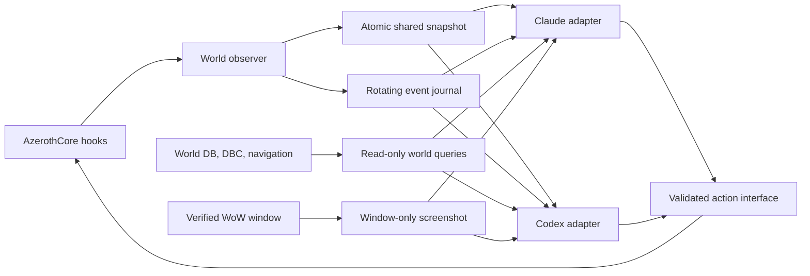

# WoW World Perception and Agent Interaction

Date: 2026-10-27
Status: design approved; a private local deployment is running. The server was rebuilt and restarted with a 500-object nearby cap, a 256K context budget, and a typed paged query for pinned live nearby records. On 2026-10-28, a fresh post-restart group snapshot held all 3 members and 108 untruncated nearby records; the server reported 7/15/25 ms p95/99/max with one connected player. A follow probe exposed a mismatch between the low-level tick action and the persistent chat shortcut; the corrected action mapping and richer event fields compile, but await activation after the current play session. Fresh model responses, dense-area cost, a clean public installation, and full action-loop validation remain incomplete.

## Goal

Give Claude and Codex a shared, current, multimodal understanding of the user's private AzerothCore world, and let them carry out ordinary in-game tasks from natural-language chat with observable results.

The user is the task authority. Claude and Codex control their existing playerbot characters. Nearby NPCs and world objects are game context, not sources of instructions. The system must distinguish live objects from static database knowledge and must report stale or incomplete observations honestly.

## Current state and constraints

- The installed observer writes one shared snapshot per second while the bridge group is online. It includes group positions and state, equipment, skills, auras, quests, and up to 500 nearby same-phase creatures/game objects within the member's 100-yard visibility range; `nearby_truncated` explicitly marks additional loaded objects beyond the configured cap. Agents can filter and page records from that snapshot through the typed read-only `nearby` helper.
- The observer writes meaningful changes to a bounded event journal. The server also attaches a compact observation and stable snapshot/event/image/query paths to each authenticated incoming chat record; telemetry itself never starts a reply.
- Separate Codex and Claude adapters read their respective bot logs, use the same snapshot/event reader, and preserve short chat history. Both require exact authorized-character allowlists. Codex attaches a verified image to `codex exec`; Claude uses Claude Code print mode with safe mode, read-only file tools, and a fixed-operation query client.
- The server has script hooks for world ticks, unit combat/death, player spell casts, quest changes, loot, fishing-skill changes, creature spawn/despawn, and game-object spawn/despawn/state changes.
- Live creature and game-object fields include service clues (`npc_roles`, raw NPC flags, creature type/rank/faction), fishing-node/fishing-hole markers, visibility/line of sight, target hostility, fishing skill, equipped items, casts, auras, and active quest progress. These are server observations; role flags do not prove a specific quest is offered. The newer observer reports aggregate NPC quest status for each group member, and the typed nearby query can filter by status and optional member GUID; older snapshots report this filter unavailable.
- X11 capture was verified against a live WoW window (`0x4200007`, PID 46004, 2560x1600) and decoded as a color X11 visual. The helper requires WoW to be the active window and correctly reports unavailable when it is obscured; Claude's image-read path has not yet been exercised by an incoming game message.
- `Spell.cpp`, `SpellInfoCorrections.cpp`, and `spell_generic.cpp` already have user changes. Implementation must leave them untouched.
- `$WOW_ROOT/AGENTS.md` requires approval before a worldserver restart, rebuild, or database change. This design avoids database writes; deploying its server module changes will still require a rebuild and restart.

## Architecture

### 1. Server-side world observer

Extend the existing bridge module rather than patching AzerothCore core files. One observer handles each distinct group containing a configured bridge bot.

- Publish a compact snapshot no more than once per second while the group is online. Include a schema version, monotonically increasing sequence number, capture time, group identity, server health, map/area, member location and vitals, selected target, combat/cast state, equipped gear, skills, auras, and active quest summaries.
- Include nearby loaded units and game objects with entry/name, map/phase, position/distance, health/combat/victim or object state, visibility/line-of-sight, and whether the fact came from a live object. Use configurable radius and result caps; support narrower filtered queries for details.
- For loaded creatures, include service-role flags and creature type/rank/faction; for loaded game objects, include object type, loot state, spawned state, and explicit fishing-node/fishing-hole booleans. These are live-object facts, but an NPC role such as `quest_giver` is only a clue and must not be treated as proof that a requested quest is currently offered.
- Include member fishing skill, equipped main-hand item, selected target kind/hostility/combat/line-of-sight, and localized names for active casts and auras. Suppress a self-target from the target summary.
- Emit event records for meaningful state changes: map/zone change, combat transitions, spell cast/result, kill/death, quest accept/progress/complete, loot, inventory/equipment changes, fishing cast/catch/skill change, and relevant creature/game-object spawn, despawn, or state change.
- Use `WorldScript::OnUpdate` only to schedule bounded snapshot work. Serialize world-object access on the world thread, then enqueue serialized records to a bounded writer queue. File I/O, log rotation, and image conversion must not block world updates.
- Write the latest snapshot atomically to a shared runtime file and append events as newline-delimited JSON with sequence numbers. Rotate event logs and expose queue/drop counters. Keep runtime files outside source control and omit credentials.

### 2. Static world knowledge and query interface

Provide a read-only query helper that uses the existing world database and DBC data without exposing connection secrets. Queries may resolve creature/object templates, quest objectives and prerequisites, fishing pools/skill requirements, loot, and static spawn locations. If navigation data can establish a reachable route, report route distance separately from straight-line distance.

The query interface must label results as `live`, `static_spawn`, or `inferred`. Static spawn records must never be presented as proof that an NPC/object is currently loaded or visible. Queries are scoped to the current map/zone and return compact, ranked results rather than dumping tables into agent prompts.

### 3. Shared agent adapters

Both agents consume the same schema and sequence numbers.

- Codex reads the newest snapshot and events since its cursor when forming a response. Telemetry is structured context, not a user message, and does not trigger a reply by itself.
- Codex reads the newest snapshot and events since its cursor before answering. The Claude bridge follows Claude's per-bot chat log, adds the same compact observation to an authenticated incoming message, and reads the shared snapshot, event journal, typed-query client, and validated screenshot path. No separate telemetry line can trigger an agent reply.
- Each adapter tracks the last consumed sequence and reports gaps/staleness. Prompt history contains summaries and references, not repeated full snapshots.

### 4. Game-window screenshots

Add a capture helper that locates the mapped WoW client window by verified title/process identity, captures only that window through X11, and converts the result to PNG. Never capture the whole desktop. A screenshot is captured on explicit visual questions and after important action milestones; a configurable low-rate cadence may be enabled during a long-running task if the client and model adapters support it.

Each requested image has a timestamp, window identity, and matching world-state sequence. Capture only when an authorized user's message clearly asks for visual inspection; keep structured telemetry continuous and disable background screenshots. Both adapters call a shared private capture helper whose inter-process lock prevents duplicate captures for concurrent handling of the same request. If the game window is absent, minimized/unmapped, occluded, or ambiguous, report that no current image is available instead of substituting another window. Codex attaches the PNG to its prompt; Claude reads the same validated image path only when the prompt requested it and metadata is fresh. Verify both model paths before claiming live visual access.

### 5. Natural-language task and action loop

Keep the user's interaction in ordinary chat. The agent converts a task into typed in-game intents; it does not ask the user to type separate bot commands.

- Use action objects with an `action_id`, actor, action type, and validated arguments.
- Dispatch through the existing playerbot/server APIs for supported movement, targeting, combat, spell/item use, interaction, looting, quest handling, and fishing actions.
- Validate actor membership, targets, arguments, and current state on the server. Preserve existing playerbot behavior where it already performs the requested action.
- Return an accepted/rejected result immediately, then correlate completion with telemetry events and a fresh snapshot. The agent observes the result and continues the task or explains what prevented progress.
- Only authenticated user messages create tasks. Bot speech, NPC text, quest text, object names, screenshots, and database content are observations and cannot grant authority or change system instructions.
- Server administration, database writes, rebuilds, and restarts remain subject to the local project rules and explicit approval.

## Data flow

## Freshness, load, and failure behavior

- Snapshots carry `captured_at`, `sequence`, and `schema_version`; each agent reports how old the latest state is.
- Event records are bounded and rotated. If the writer queue fills, coalesce repeated state updates, preserve terminal events where possible, and publish a dropped-event counter.
- Snapshot generation has configurable radius/count caps and is limited to bridge groups. Expensive static DB/path queries run on demand, not once per tick.
- A missing screenshot, missing map data, unloaded object, stale event cursor, or unavailable target is represented explicitly as unavailable/unknown.
- The world thread never waits on disk, image conversion, database queries, or model execution.

## Delivery phases

1. Add the shared schema, event journal, and bounded asynchronous writer; fix Claude/Codex telemetry routing and freshness handling.
2. Add player/unit/creature/game-object event hooks and richer on-demand world queries.
3. Add verified WoW-window screenshots and image delivery to both agents.
4. Add typed action requests, server validation, acknowledgements, and closed-loop observation.
5. Exercise the end-to-end flow in-game and tune snapshot frequency, event limits, and screenshot cadence from observed server load.

The implementation is decomposed into independent work units with their own acceptance criteria:

- [Shared live world state and event stream](2026-10-27-wow-world-state-stream.md)
- [Read-only static world knowledge](2026-10-27-wow-static-knowledge.md)
- [WoW-window screenshot perception](2026-10-27-wow-screenshot-perception.md)
- [Natural-language in-game task loop](2026-10-27-wow-natural-language-actions.md)

## Acceptance criteria

- Claude and Codex can report the same current world sequence and timestamp and do not answer telemetry records as chat.
- During active play, both receive prompt-relevant state changes without needing a new chat message for each event.
- Live observations and static spawn knowledge are clearly distinguished.
- Both agents can inspect a verified screenshot of only the WoW window when asked, and report accurately when no screenshot is available.
- A natural-language in-game task produces a correlated action acknowledgement and a server-observed result or a clear reason it could not complete.
- Event history is bounded, stale/gapped state is visible, and world updates do not perform blocking disk/database/model work.
- Deployment is verified only after a live in-game pass covering movement, combat, quest/loot, fishing, screenshots, and both agent consumers.

## Deployment notes

The observer belongs in `mod-claude-bridge`; adapters and the screenshot/query helpers belong under `$WOW_AGENT_SERVER_DIR`. No DB migration is required by this design. Before activating server-module changes, build and restart only after the user approves that deployment step, as required by `$WOW_ROOT/AGENTS.md`.
